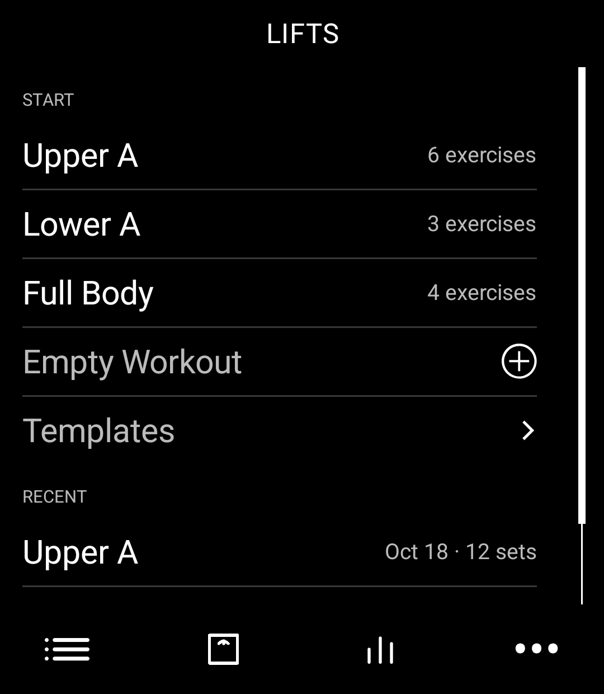
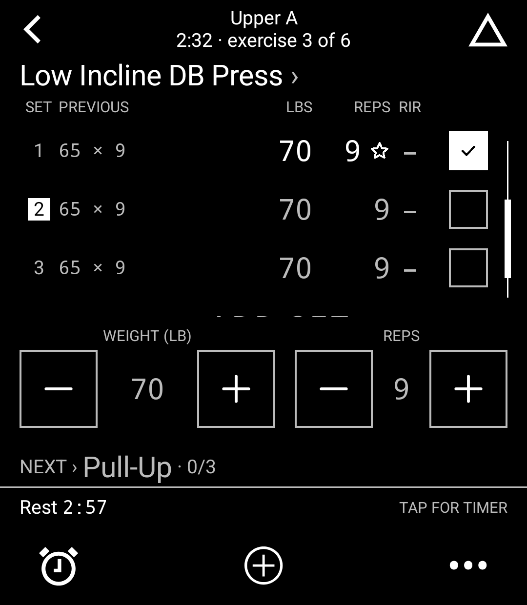
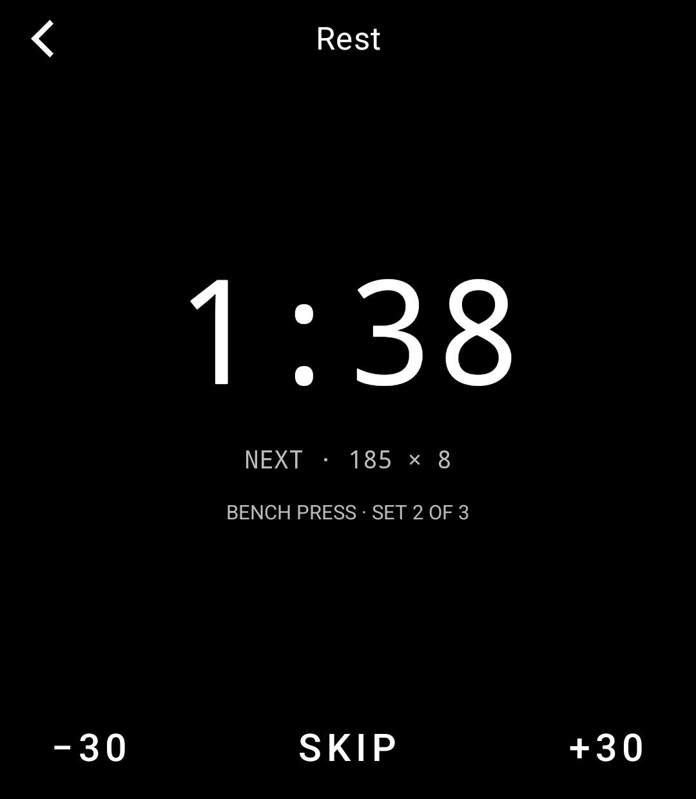
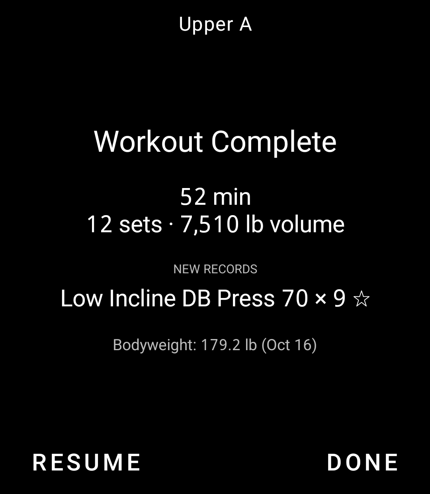
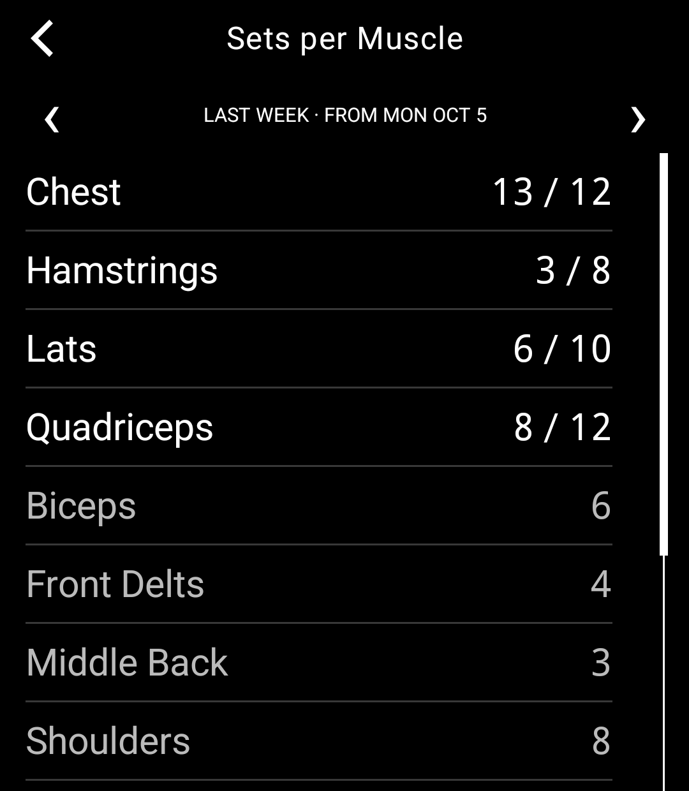

# Lifts

A strength-training log for the [Light Phone III](https://www.thelightphone.com/). Log every set at the gym without a
smartphone, then take your whole training history home as plain files you can read, keep, or hand to an AI.

By [@Tczerwien](https://github.com/Tczerwien). Free and open source.

<p>
  
  
  
  
  
</p>

## Features

- **Templates.** Plan each workout's exercises with target sets, a rep range, reps in reserve (RIR) and rest. Give an
  exercise up to three alternatives for when its machine is taken.
- **Quick logging.** Every set shows what you lifted last time. Large + and − buttons adjust it and one tap logs it.
  Warm-ups, sets to failure, drop sets and supersets.
- **Rest timer.** Starts when you log a set. At zero the screen flashes and a short beep plays (the beep can be turned
  off). The screen stays on while you rest.
- **Records.** Personal records, estimated one-rep max, rep maxes and best volume set, starred the moment you lift them.
- **Exercise library.** 873 exercises from free-exercise-db, searchable by name or body part, plus your own. Pin a form
  cue to any exercise.
- **Progress without charts.** History, a bodyweight log, workouts per week, and hard sets per muscle each week against
  targets you set.
- **Deload switch.** One switch turns a workout into a deload: fewer sets (half by default) at an easier effort. Your
  next normal workout still starts from your last normal one.
- **Plate calculator.** What to load on each side, from your own plates and bars. Pounds or kilograms.
- **Backups.** Made automatically after every workout and once a day, with weekly and monthly copies kept. Restore on
  the phone, or upload a backup from a computer.

## Exports for people and AIs

Lifts keeps four export files up to date as you train. Download them on a computer with LightOS's Tool Manager
(Lifts › Exports):

- `training-log.md`: your whole history as plain text. A summary comes first (current records, estimated one-rep-max
  trends, weekly sets per muscle, bodyweight), then every workout in a compact notation explained at the top of the
  file. It is written to be read by you or pasted into an AI assistant to ask about your training.
- `workouts.json`: everything, losslessly, in a versioned format for programs.
- `strong.csv`: the CSV format Strong exports, which other workout apps can import.
- `bodyweight.csv`: your weigh-ins.

## Privacy

Everything stays on the phone. There is no account, no cloud, no analytics and no advertising. Your data leaves the
phone only when you download an export or a backup with Tool Manager.

Lifts declares no permissions of its own. The installed app still lists several, internet access and the camera among
them, because the Light SDK's libraries declare them for every tool built with it. Lifts has no code that goes online
or uses the camera.

## Installing

Lifts is on its way to Light's community Tool Library. Once Light approves it, install it from the Tool Library on
your Light Phone III.

Light builds every Tool Library tool from a public commit of its source and signs the APK itself, so the app on your
phone is built by Light from this repository's code.

## Building

This repository is a copy of Light's [light-sdk](https://github.com/lightphone/light-sdk), because a tool is built
inside the SDK. Lifts is the `tool/` module; everything else is Light's.

You need JDK 17 and the Android SDK (set `sdk.dir` in `local.properties`, or `ANDROID_HOME`). Then:

```sh
./gradlew :tool:testDebugUnitTest :tool:assembleDebug
```

The debug APK, `tool/build/outputs/apk/debug/tool-debug.apk`, runs on an Android emulator. Light suggests one shaped like
the phone: 1080 × 1240, API 34, no Google Play services. Light's [documentation](../docs) covers the SDK.

## Support

Lifts is free, with no ads and nothing to unlock. If it helps your training and you'd like to say thanks, you can leave
a tip on [Ko-fi](https://ko-fi.com/tczerwien).

Bug reports and ideas are welcome as [issues](https://github.com/Tczerwien/lifts-tool/issues).

## Licence

Lifts' code (`tool/`) is under the MIT License: see [tool/LICENSE](../tool/LICENSE) and [tool/NOTICE](../tool/NOTICE).
The Light SDK around it is The Light Phone's, also under the MIT License ([LICENSE](../LICENSE)).

The exercise library comes from [free-exercise-db](https://github.com/yuhonas/free-exercise-db), which its author
released into the public domain.

Lifts was written with the help of Claude Code, Anthropic's AI coding assistant.
